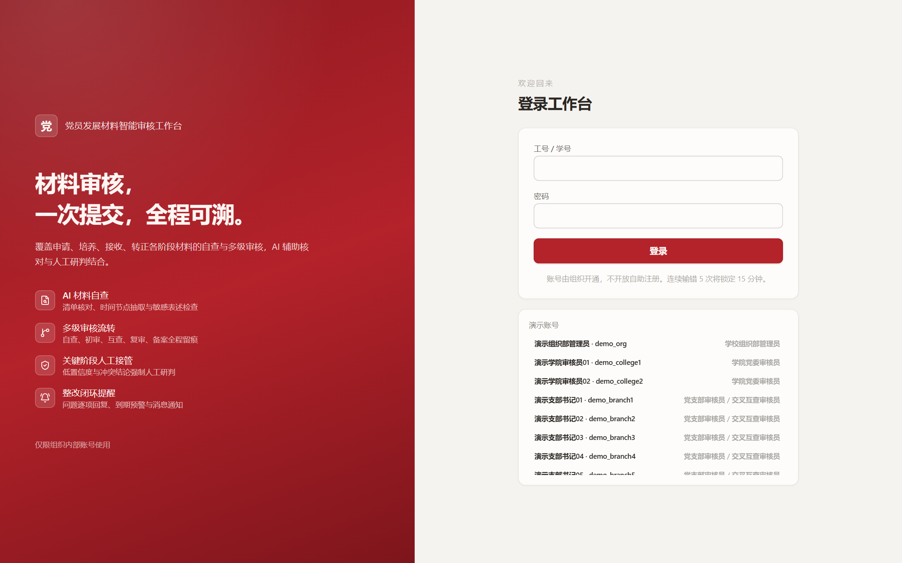
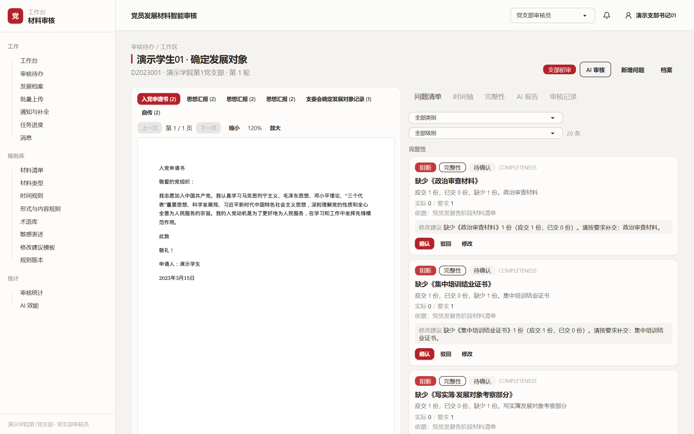
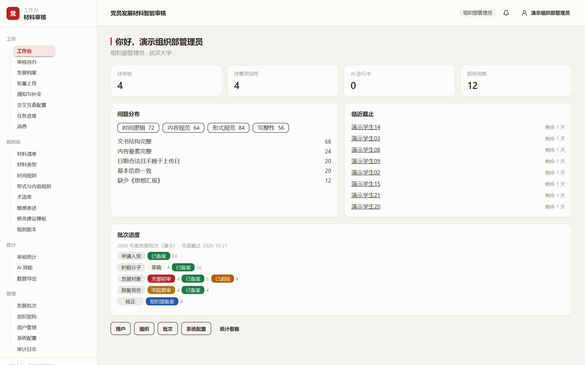
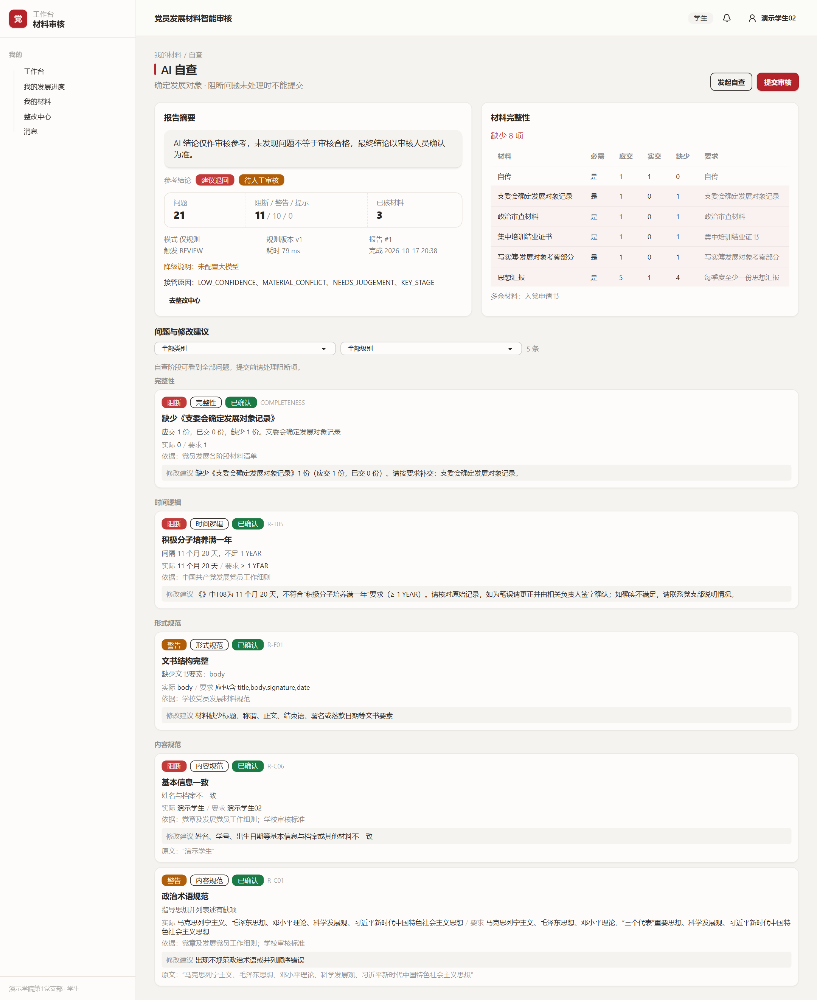
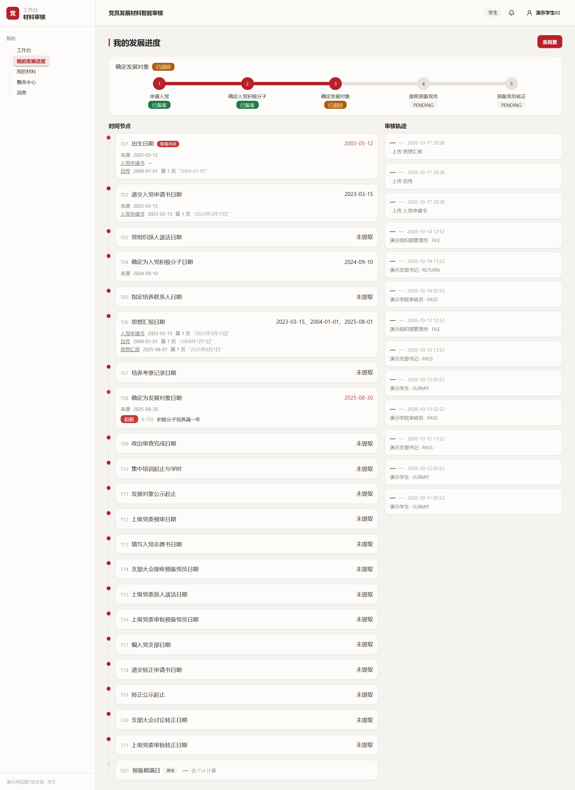

# whu-party-review · 党员发展材料智能审核工作台

武汉大学团队项目。面向党员发展全流程的材料智能审核系统：学生提交材料 → 解析入库 → AI 自查与规则引擎核查 → 支部 / 学院 / 组织部多级审核 → 整改回复 → 备案归档，全链路留痕、可追溯。

已增加 Windows 本地程序：解压完整 `PartyReview` 文件夹到英文路径后，双击 `PartyReview.exe`，无需单独安装 Python、Node.js 或 PostgreSQL。首次登录、演示入口、数据备份和源码构建见 [本地程序说明](docs/Windows本地程序使用说明.md)。

审核端已补齐原文预览拖框新增问题，以及时间节点抽取记录逐条新增、修改、删除，使用方法和验证结果见 [原文框选与节点抽取校正](docs/原文框选与节点抽取校正.md)。

2026-10-23 已整合 CE 成果，补齐档案、多身份授权、批次、规则试运行与配置、统计导出及系统参数，详见 [CE 功能补齐与验收](docs/CE功能补齐与验收.md)。



## 技术栈

| 层 | 技术 |
| --- | --- |
| 后端 | Python 3.12+ · FastAPI · SQLAlchemy 2 · PostgreSQL 14+（本轮实测 16） |
| 前端 | React 19 · React Router 7 · Vite 8 · Tailwind CSS 4 · daisyUI 5 |
| 能力 | PDF/DOCX 解析（PyMuPDF、python-docx）· 规则引擎（政治术语 / 时间节点）· 可选大模型语义核查 · 可选 PaddleOCR |

## 目录结构

```
backend/        FastAPI 后端与回归测试
frontend/       React 前端、身份专属工作台与自动化测试
desktop/        Windows 本地程序启动、打包和桌面回归测试
docs/           RUN.md 运行说明 · DESIGN.md 设计基线 · 开发说明 · 原始包说明
paper/          论文 main.pdf（35 页）+ LaTeX 源
figures/        论文插图（drawio 源 + PDF/PNG 导出）
screenshots/    业务界面、精简工作台与身份登录截图
database/       演示库 SQL（24 档案 / 72 提交包 / 84 材料版本 / 276 问题）
start.cmd       一键启动脚本（Windows）
start.ps1
```

> **未入库内容**：`backend/storage/`（508 份材料 + 508 份预览，约 3.4G）与 `frontend/dist/`。材料可在系统内「初始化演示数据」自动生成，`dist` 用 `npm run build` 构建。桌面运行时、打包输出、`data/`、`demo-data/` 及首次登录信息同样不入库。它们均已写入 `.gitignore`。

## 快速开始（Windows）

```powershell
# 1. 建库（PostgreSQL 14+）
createdb -U postgres party_review

# 2. 后端依赖
python -m venv .venv
.\.venv\Scripts\python.exe -m pip install -r backend\requirements.txt
Copy-Item backend\.env.example backend\.env    # 填写数据库连接

# 3. 前端构建（首次必须，后端同源托管 dist）
cd frontend; npm ci; npm run build; cd ..

# 4. 恢复演示数据（推荐，可选）
psql -U postgres -d party_review -f database\party_review_20261017.sql

# 5. 启动
.\start.ps1        # 或双击 start.cmd
```

访问 http://127.0.0.1:8000 。演示账号 `demo_stu01`～`demo_stu24`（学生）、`demo_branch1`～`demo_branch6`（支部）、`demo_college1`～`demo_college2`（学院）、`demo_org`（组织部），统一密码 `Demo@2026`；管理员 `admin`（密码为初始化数据库时设置的值）。

不恢复备份也可以：启动后在系统设置中调用演示数据初始化，材料 PDF 会现场生成（约 1 分钟）。

更细的运行、测试与验证说明见 **[docs/RUN.md](docs/RUN.md)**。

## 界面预览

| 审核工作区 | 组织部工作台 |
| --- | --- |
|  |  |

| AI 自查报告 | 学生发展进度 |
| --- | --- |
|  |  |

## 分支模型

| 分支 | 用途 | 保护规则 |
| --- | --- | --- |
| `main` | 生产/稳定分支，随时可交付 | 仅可通过 PR 合并，需 1 人评审 |
| `dev` | 开发集成主分支，日常开发汇合于此 | 仅可通过 PR 合并 |

## 协作流程

1. 从 `dev` 拉取功能分支：

   ```bash
   git checkout dev && git pull
   git checkout -b feature/xxx
   ```

2. 开发并提交（提交信息参考 Conventional Commits：`feat:` / `fix:` / `docs:` / `refactor:` …）
3. 推送功能分支并提 PR 合入 `dev`
4. 功能稳定后，由负责人发起 `dev → main` 的 PR 完成发布

## 队友须知

- 所有改动走 PR，**不要直接向 `main` / `dev` 推送**
- 提交前先 `git pull --rebase origin dev` 保持分支同步
- 遇到冲突，先沟通再解决，不要强推（force push）
- **不要提交** `backend/storage/`（材料原件）、`frontend/dist/`、`.venv/`、`node_modules/`、`.env` —— 均已在 `.gitignore` 中忽略
